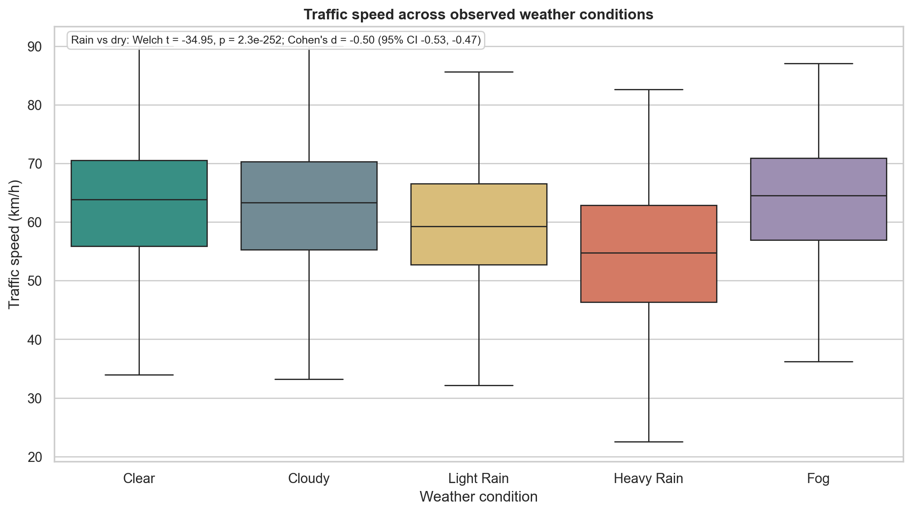
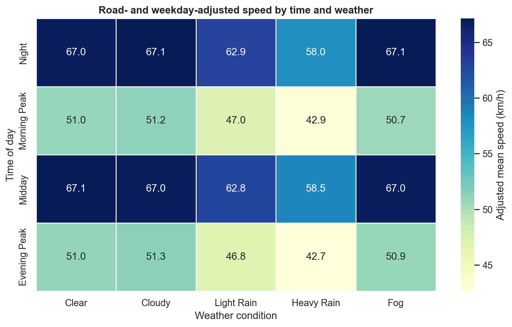
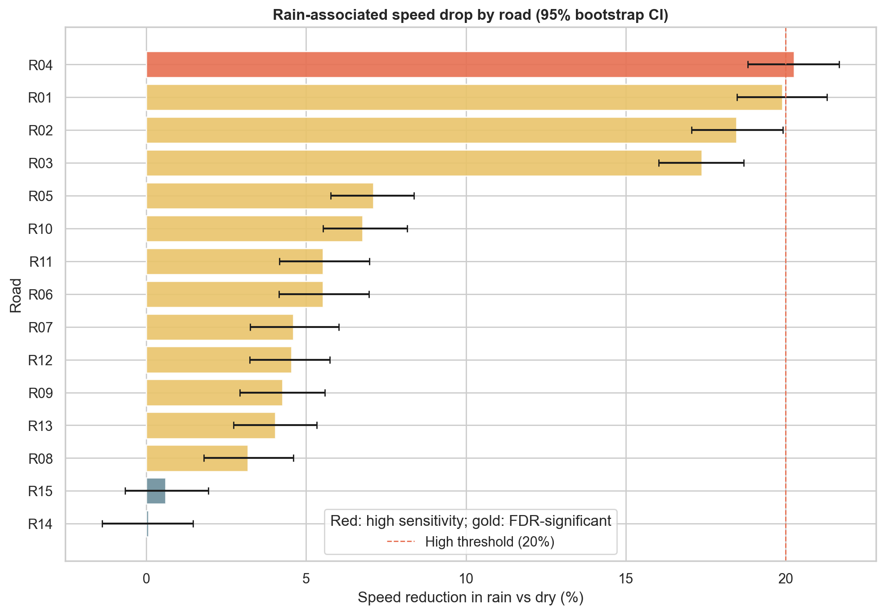
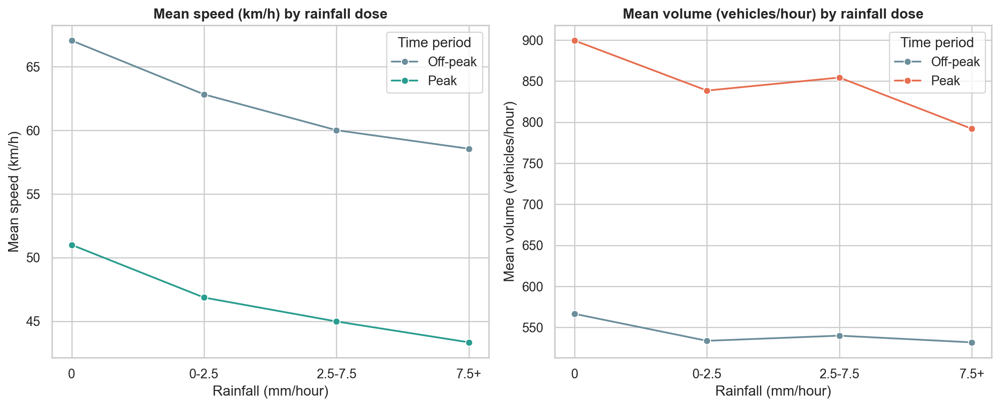
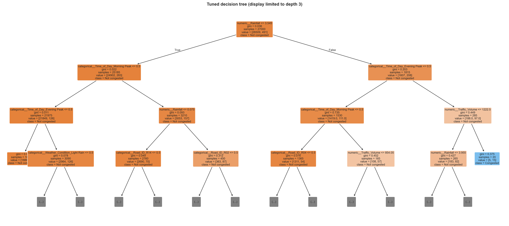
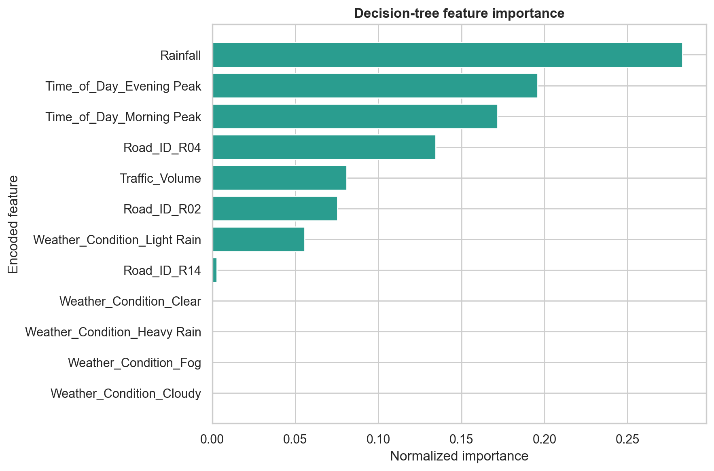
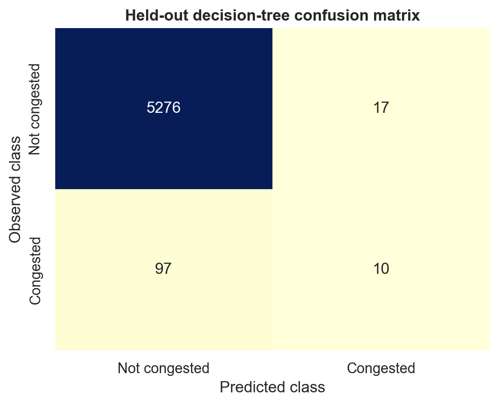

# Smart City: Does Weather Affect Traffic?

**Speed null (H0):** Rainfall has no effect on mean traffic speed: mean speed is equal in rain and dry conditions after controlling for time of day and weekday.  
**Speed alternative (H1):** Rainfall reduces traffic speed and therefore is associated with increased congestion.  
**Volume null (H0-volume):** Rainfall does not change mean traffic volume.  
**Volume alternative (H1-volume):** Rainfall changes mean traffic volume.  
Significance level: alpha = 0.05.

## Executive summary
Across 32,400 cleaned hourly sensor readings from 15 roads, rain was associated with a 8.1% lower mean speed (Cohen's d=-0.50; 95% CI -0.53 to -0.47). After controlling for time of day, weekday, and road, each additional mm/hour was associated with 0.97 km/h lower speed (95% CI -1.02 to -0.93). Effects varied by corridor; prioritize R04, R01, R02, R03, R05. These are observational/synthetic associations, not causal estimates.

## Formal test and raw-versus-controlled comparison
The primary speed test is OLS with HC3 robust standard errors, adjusted for time of day, weekday, and road. Decision: **Reject H0** (rainfall coefficient -0.97 km/h per mm/hour; 95% CI -1.02, -0.93; p=<0.001). The simple binary rain-vs-dry Welch test gives a -5.12 km/h difference (-8.1%; p=<0.001; binary-test decision: Reject H0).

The unadjusted continuous rainfall slope is -0.96 km/h per mm/hour; after controlling for road, time of day, and weekday it is -0.97 km/h per mm/hour. The binary contrast compares all wet hours with dry hours and therefore also reflects rainfall intensity and the mix of observations; the regression coefficients compare one additional mm/hour. Their different magnitudes are not directly interchangeable. The slope change after adjustment describes the contribution of road/calendar/time composition in this dataset; remaining unmeasured conditions can still confound the association. Volume test decision: **Reject H0_volume** (Welch p=<0.001).

## Key insights
1. Rain vs dry speed: -8.1% mean change (95% bootstrap CI -8.6% to -7.7%); Cohen's d=-0.50 (medium); Cliff's delta=-0.27 (95% bootstrap CI -0.29 to -0.24; small). Welch p=<0.001; controlled-H0 decision: Reject H0.
2. Controlled rainfall slope: -0.97 km/h per mm/hour (robust HC3 95% CI -1.02 to -0.93; p=<0.001); model R-squared=0.784.
3. Weather-group speed test: Kruskal-Wallis H=1320.8, p=<0.001, epsilon-squared=0.041 (small); Dunn pairwise results use Bonferroni correction.
4. Rain-related volume change: -7.2% (95% bootstrap CI -8.0% to -6.3%); Cohen's d=-0.21; Welch p=<0.001; decision: Reject H0_volume.
5. Road effects are heterogeneous: road-by-rain interaction F=261.7, p=<0.001; observed drop spread=20.2 percentage points. The largest peak-period stratified drop was 11.6% in Evening Peak (Weekend); high-sensitivity roads: R04.
6. The largest estimated rain-associated speed drops are R04 (20.3%, d=-1.46, FDR q=2.07e-102), R01 (19.9%, d=-1.50, FDR q=1.05e-104), R02 (18.5%, d=-1.37, FDR q=3.8e-93), R03 (17.4%, d=-1.30, FDR q=8.58e-90), R05 (7.1%, d=-0.55, FDR q=9.28e-24).
7. The held-out decision tree achieved ROC-AUC=0.945, F1=0.149, recall=0.093; without volume, ROC-AUC remained 0.945 but default-threshold recall was 0.000. Logistic regression ROC-AUC=0.953, majority baseline ROC-AUC=0.500. Tree CV ROC-AUC=0.935 +/- 0.009.

## Visual evidence

## Road sensitivity ranking
Sensitivity thresholds, stated before interpretation: High = at least 20% lower speed in rain; Moderate = 8% to under 20%; Low = under 8%. P-values are adjusted across roads with Benjamini-Hochberg FDR at alpha=0.05. Cohen's d magnitude labels use 0.2/0.5/0.8 as small/medium/large; epsilon-squared uses 0.01/0.06/0.14.

| Rank | Road | Speed drop | 95% bootstrap CI | Cohen's d (95% CI) | FDR q | Class |
|---:|---|---:|---:|---:|---:|---|
| 1 | R04 | 20.3% | [18.8, 21.7]% | -1.46 [-1.57, -1.35] | 2.07e-102 | High |
| 2 | R01 | 19.9% | [18.5, 21.3]% | -1.50 [-1.62, -1.39] | 1.05e-104 | Moderate |
| 3 | R02 | 18.5% | [17.1, 19.9]% | -1.37 [-1.48, -1.26] | 3.8e-93 | Moderate |
| 4 | R03 | 17.4% | [16.0, 18.7]% | -1.30 [-1.41, -1.19] | 8.58e-90 | Moderate |
| 5 | R05 | 7.1% | [5.8, 8.4]% | -0.55 [-0.66, -0.45] | 9.28e-24 | Low |
| 6 | R10 | 6.8% | [5.5, 8.2]% | -0.53 [-0.64, -0.43] | 1.42e-21 | Low |
| 7 | R11 | 5.5% | [4.2, 7.0]% | -0.41 [-0.52, -0.31] | 1.01e-13 | Low |
| 8 | R06 | 5.5% | [4.2, 7.0]% | -0.41 [-0.53, -0.31] | 3.2e-14 | Low |
| 9 | R07 | 4.6% | [3.3, 6.0]% | -0.34 [-0.45, -0.24] | 6.32e-10 | Low |
| 10 | R12 | 4.5% | [3.2, 5.7]% | -0.36 [-0.46, -0.26] | 1.41e-11 | Low |

## Decision-tree interpretation
Congestion is defined as speed below 60% of that road's training-period 85th-percentile speed. The free-flow reference uses only the first approximately 75 of 90 days. No Traffic_Speed feature is used. Traffic_Volume is a plausible sensor input available to a traffic operator, but can be partly downstream of weather-related diversion and congestion; compare both tree variants.

Held-out metrics (last approximately 15 days): accuracy 0.979, precision 0.370, recall 0.093, F1 0.149, ROC-AUC 0.945; confusion matrix [[5276, 17], [97, 10]]. Tuned tree time-series CV ROC-AUC: 0.935 +/- 0.009. Without volume, ROC-AUC is 0.945 (with-volume: 0.945), but default-threshold recall is only 0.000, so the ranking signal remains while positive-class decisions are inadequate. Logistic-regression ROC-AUC: 0.953; majority baseline ROC-AUC: 0.500. See `outputs/model_metrics.csv` for all metrics.

Extracted tree rules (encoded categories are indicator splits; 1 means the named category is present):
- `IF Rainfall <= 3.54 AND NOT Time=Morning Peak AND NOT Time=Evening Peak THEN Congested=0 (leaf support=18885, training purity=100%)`
- `IF Rainfall <= 3.54 AND NOT Time=Morning Peak AND Time=Evening Peak AND NOT Weather=Light Rain AND NOT Road=R04 THEN Congested=0 (leaf support=2576, training purity=98%)`
- `IF Rainfall <= 3.54 AND Time=Morning Peak AND Rainfall <= 0.07 AND NOT Road=R14 AND Traffic_Volume <= 995.15 THEN Congested=0 (leaf support=1754, training purity=99%)`
- `IF Rainfall > 3.54 AND NOT Time=Evening Peak AND NOT Time=Morning Peak AND NOT Road=R04 AND NOT Road=R02 THEN Congested=0 (leaf support=1183, training purity=98%)`
- `IF Rainfall <= 3.54 AND Time=Morning Peak AND Rainfall <= 0.07 AND NOT Road=R14 AND Traffic_Volume > 995.15 THEN Congested=0 (leaf support=822, training purity=96%)`

## Data quality and assumptions
Input source: `data\traffic_raw.csv`; synthetic data: **True**; rows after cleaning: 32,400. The synthetic observations are generated with seed 42; they are not evidence about a real city. 0 unparseable timestamps were dropped. Exact duplicates were removed; impossible speeds outside 5-90 km/h, negative volume, and negative rainfall were set missing and imputed by road/time medians or rainfall/weather rules. Time period and weekday were recalculated from timestamp. Valid IQR outliers were retained and listed in `outputs/iqr_outlier_summary.csv`.

The group normality checks use Shapiro-Wilk samples capped at 5,000 observations; Levene tests assess variance equality. Because large samples make normality tests sensitive and group variances may differ, Kruskal-Wallis plus Dunn-Bonferroni is reported for weather groups, alongside Welch tests for the binary comparison. Bootstrap intervals use 2,000 seeded resamples. Statistical significance is not practical significance.

These are observational associations. Rainfall may coincide with unmeasured accidents, roadworks, events, visibility changes, or route choice. Synthetic-data effects are designed into the generator and must not be presented as city measurements. Congestion is a policy-defined threshold, class prevalence affects accuracy, and Traffic_Volume may be downstream of rainfall. Validate with audited local sensors, incident/event covariates, and prospective pilots before operational deployment.

## Practical action plan
| Action | Roads/Area | Evidence | Priority | Timeline | Expected impact |
|---|---|---|---|---|---|
| Inspect drainage, underpass pumps, and flood paths | R04, R01, R02, R03, R05 | Road sensitivity ranking; prioritize High roads and FDR-significant corridors | High | 0-6 months | Reduce standing water and preserve wet-weather capacity |
| Pilot rain-triggered adaptive signal timing | High-sensitivity arterials; peak approaches | Rain x peak-hour speed effects and dose-response figure | High | 3-9 months | Reduce queue growth during rainfall peaks |
| Deploy dynamic speed limits and variable message signs | High- and Moderate-sensitivity corridors | Observed speed losses and heavy-rain dose response | High | 3-6 months | Smooth speeds and warn drivers before bottlenecks |
| Offer rerouting and corridor alerts | R04, R01, R02 | Largest road-level rain effects; revalidate against live data | Med | 3-6 months | Divert trips before constrained links saturate |
| Staff incident response for peak-hour rain events | Citywide peak periods; deploy first to ranked roads | Rain effects are stronger/heterogeneous across corridors | Med | Next wet season | Shorten incident clearance and queue duration |
| Track post-deployment KPIs | Citywide and by road | Baseline: speed drop in rain, congestion hours/rain event, incident rate | High | Monthly; evaluate after 6 months | Quantify operational benefit and avoid relying on modeled association |

## Reproducibility
Run `python -m src.traffic_weather_analysis` from the project root, or run the notebook top to bottom. The model is saved at `outputs/decision_tree_model.joblib`; source and all generated artifacts are listed in `README.md`.
